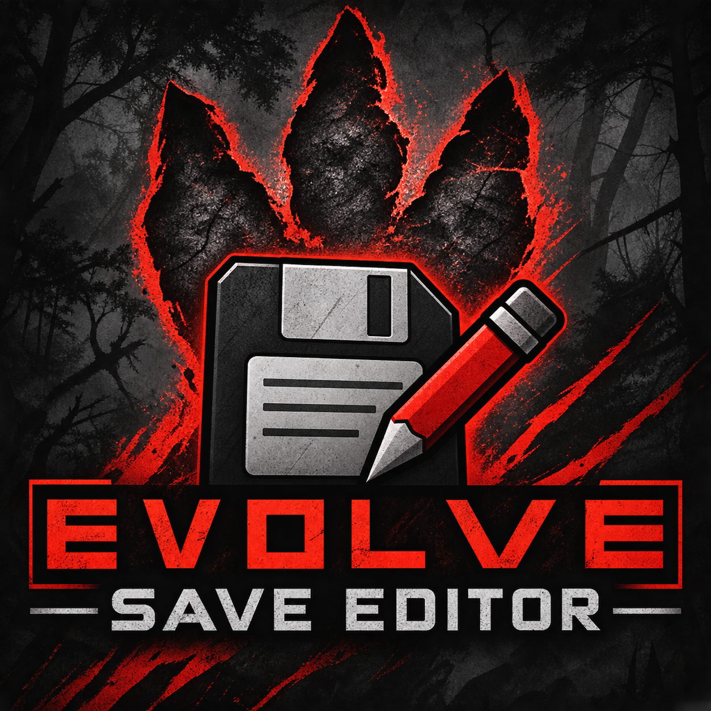

<p align="center">
  
</p>

<h1 align="center">Evolve Save Editor</h1>

<p align="center">
  A save editor for <b>Evolve Legacy</b>: change your XP, level, character XP and every other value in your profile.<br>
  <b>Made by CeZeY22</b>
</p>

---

## Features

- **XP editing:** Overall XP (your level), Hunter XP, Monster XP and medal XP.
- **Per-character XP** for every hunter and monster, shown by name (Parnell, Bucket, Griffin, Wraith...).
- **All values tab:** search and edit any of the ~2,000 values stored in your profile.
- **Automatic totals:** a change to one character is added to the Hunter/Monster and Overall totals for you.
- **Finds your save automatically:** every Steam account on the PC, plus Steam emulator saves. A **Browse...** button covers anything else.
- **Backup before every save**, with a button that opens the backup folder.
- **Key keeper:** keeps the save's decryption key up to date while you play (see [How it works](#how-it-works)).
- **One portable exe.** No install, no Python needed.

## Download

Get **`Evolve Save Editor.exe`** (or the zip) from the [Releases](../../releases) page.

**Requirements:** Windows 10 or 11 (64-bit) and Evolve Legacy.

## How to use

1. **Close Evolve.**
2. Run `Evolve Save Editor.exe`. If you have more than one profile, pick yours from the **Profile** list.
3. Make your changes:

   | Tab | What you can edit |
   |---|---|
   | **XP** | Overall / Hunter / Monster XP and medal XP. Your level is worked out from Overall XP. |
   | **Characters** | XP for each hunter and monster |
   | **All values** | Every value in the save, with search |

   Edited values turn **yellow**.
4. Click **Save to game**. Your current save is backed up first.
5. Start Evolve.

> [!IMPORTANT]
> Always close Evolve before saving. The game keeps your profile in memory and overwrites the file when it saves.

## How it works

Evolve stores your profile in an encrypted `attributes.xml` (a `TRSEVLVPC` header followed by XML encrypted with a fixed XOR keystream). The key is the same for every player, and the editor ships with a known part of it.

If your save is **bigger than the part of the key the editor knows**, the **Save key** light turns yellow. In that case:

1. Leave the editor open.
2. Start Evolve and play a match.
3. When the game saves, the editor's **key keeper** learns the missing part of the key. Then press **Reload**.

You only need to do this once; the key is remembered. To learn the key, the key keeper attaches to the game (using [Frida](https://frida.re)) and hooks only the C runtime's `fwrite`. **It never changes the game's own code.**

> [!WARNING]
> Close the editor with its **X** button, not Task Manager, while Evolve is running, so it can detach from the game cleanly.

## Saves, backups and restoring

The editor finds your save here automatically:

| Copy | Location |
|---|---|
| Steam Cloud copy | `Steam\userdata\<account>\273350\remote\USER0\Profiles\default\attributes.xml` |
| Local copy | `Steam\userdata\<account>\273350\local\USER\Profiles\default\attributes.xml` |

Both copies are written when you save. Backups go to:

```
%APPDATA%\Evolve Save Editor\backups
```

Backups are named `<date>_<time>_<account>_<remote|local>_attributes.xml`. To restore one, close Evolve, then copy the backup back to the location above and rename it to `attributes.xml`.

## Troubleshooting

<details>
<summary><b>My changes disappear after starting the game</b></summary>

Steam Cloud may be putting your old save back. Turn it off for Evolve (right-click Evolve in your Steam library, then **Properties > General > Steam Cloud**) and save again with the editor.
</details>

<details>
<summary><b>My antivirus flags the exe</b></summary>

The exe is a packed Python program, and its key keeper attaches to the game's process. Some antivirus programs flag tools like that. It only reads the save data while the game writes it. Add an exception for the exe if it gets blocked.
</details>

<details>
<summary><b>"Key keeper: could not attach"</b></summary>

Try running the editor as administrator. To check that attaching works on your PC at all, run this from a command prompt:

```
"Evolve Save Editor.exe" --selftest
```

The result is shown in a message box and written to `%APPDATA%\Evolve Save Editor\editor.log`. Include that log when asking for help.
</details>

<details>
<summary><b>"No Evolve save found"</b></summary>

Start Evolve once so it creates your profile, then press **Rescan**. If your save is somewhere unusual, open its `attributes.xml` with **Browse...**.
</details>

## Character codenames

Inside the save, characters use internal codenames. The editor shows the real names; here's the full list in case it helps anyone else digging into Evolve saves:

| Class | Codename → name |
|---|---|
| **Assault** | `assaultb` Parnell · `assaultd` Hyde · `assaulte` Markov · `assaulte_blitz` Blitz Markov · `assaultf` Torvald · `assaultg` Lennox |
| **Trapper** | `trackinga` Griffin · `trackingc` Abe · `trackinge` Maggie · `trackinge_savage` Savage Maggie · `trackingf` Crow · `trackingg` Jack |
| **Medic** | `medicb` Lazarus · `medicc` Caira · `medice` Val · `medice_rogue` Rogue Val · `medicf` Slim · `medicg` Emet |
| **Support** | `supporta` Bucket · `supportc` Hank · `supportc_sgt` Sgt. Hank · `supporte` Cabot · `supportf` Sunny · `supportg` Kala |
| **Monster** | `goliatha` Goliath · `goliathmeteor` Meteor Goliath · `groundera` Kraken · `krakenelder` Elder Kraken · `teleportera` Wraith · `lurkera` Gorgon · `rockya` Behemoth |

XP is stored as `xp/<codename>/count`. The totals are `xp/overall`, `xp/merc` (hunters), `xp/monster`, `xp/mercmedals` and `xp/monstermedals`, where:

```
merc    = sum of hunter XP  + mercmedals
monster = sum of monster XP + monstermedals
overall = merc + monster
```

## Files the editor creates

Everything lives in `%APPDATA%\Evolve Save Editor\`. Delete that folder to remove it all.

| File | Purpose |
|---|---|
| `backups\` | Backups of your save |
| `keystream.bin` | Decryption key bytes learned while you play |
| `settings.json` | Last selected profile |
| `editor.log` | What the editor did (useful when asking for help) |

## Credits

Made by **CeZeY22**.

## Disclaimer

This is a fan-made tool. It is not affiliated with or endorsed by Turtle Rock Studios or 2K. Use it at your own risk, and keep your backups.
